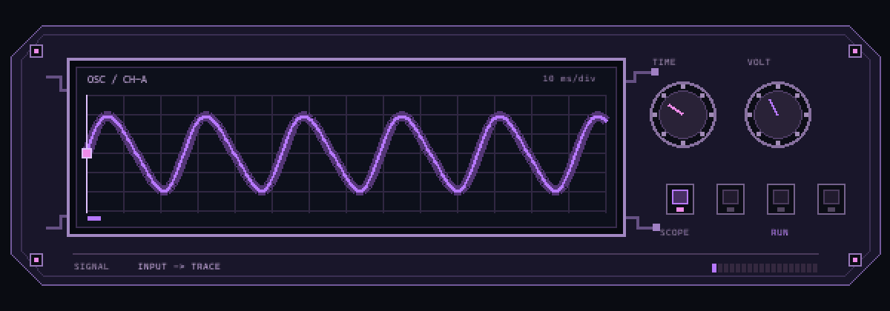
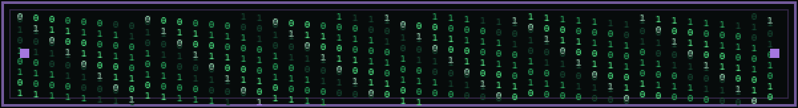

# Gustavo Tavares Espenchitt

Sou engenheiro de computação e técnico em Mecatrônica. Desde pequeno, gosto de entender como as coisas funcionam e resolver problemas, às vezes desmontando algo para descobrir. Me aventuro no software, mas é com hardware e firmware que me sinto em casa.

## Projetos

### C, ESP32 e FreeRTOS

Implementações em C17 e projetos embarcados com ESP-IDF e FreeRTOS, incluindo máquina de estados, tratamento de entradas, PWM, UART / RS-485, CRC-16 e parser incremental.

- [Embedded Electronic Systems Technical Assessment](https://github.com/imtavin/knowledgeAssessmentEletrolux)

### OBD-II Telemetry

Projeto em desenvolvimento para uma plataforma ESP32 de telemetria OBD-II somente leitura. O ramo de desenvolvimento contém uma base de protocolo e sessão testável no host; CAN, MCP2515, OBD e BLE ainda não estão integrados.

- [Repositório obd-telemetry](https://github.com/imtavin/obd-telemetry)

### Strawberry AI

Protótipo acadêmico em equipe para detectar e classificar pragas em morangos. O sistema executa inferência local com TensorFlow Lite em Raspberry Pi e combina captura de imagens, comunicação TCP/UDP e uma interface gráfica para operação em campo.

Minhas contribuições registradas nos repositórios incluem trabalho no backend Python, integração da inferência, configuração de rede e logs, além de telas e componentes da interface gráfica. O projeto demonstra integração de sistema e Linux embarcado, não desenvolvimento de firmware.

- [Visão geral e arquitetura](https://github.com/imtavin/strawberry-ai)
- [Backend Python](https://github.com/imtavin/strawberry-backend-python)
- [Interface gráfica](https://github.com/imtavin/strawberry-frontend-python)

## Tecnologias que a gente desenrola

ESP32 · ESP-IDF · FreeRTOS · UART / RS-485 · CRC-16 · testes em host · integração de sensores.

## GitHub Stats

  

## Contato

- [LinkedIn](https://www.linkedin.com/in/gustavo-espenchitt/)
- [E-mail](mailto:gustavo.t.espenchitt@gmail.com)

