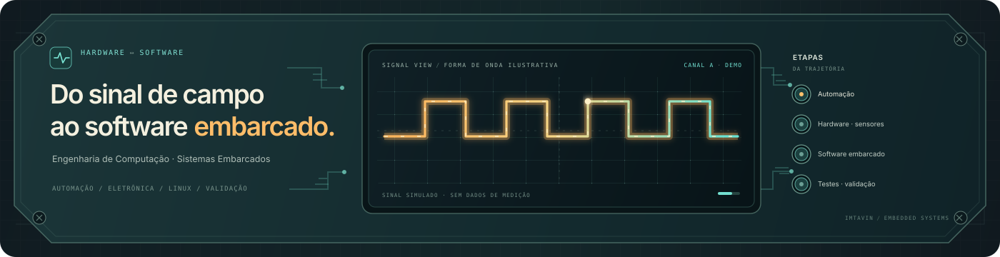

# Gustavo Tavares Espenchitt

Engenheiro de Computação com foco em software embarcado, Linux embarcado, integração de sensores e validação de software.

Automação e integração · CLPs · sensores · redes industriais

Atuei com painéis elétricos, CLPs, redes industriais e integração de sensores em aplicações de automação.

Hardware e sensores · ESP32 · Raspberry Pi · eletrônica

Na Bosch, participei de projetos com ESP32 e Raspberry Pi e de uma célula de visão computacional com robô KUKA. No TCC Strawberry AI, contribuí da modelagem 3D à integração eletrônica.

Software embarcado · Java · Embedded Linux · telemetria

Na Fiscaltech, desenvolvo e mantenho software Java em Linux embarcado para equipamentos de fiscalização e pesagem veicular, integrando módulos de medição e sensores.

Testes e validação · cenários de campo · CAN · K-Line

Desenvolvo testes automatizados, reproduzo cenários de campo e valido o comportamento no equipamento. Na pós-graduação da UTFPR, estudo arquitetura ARM e redes veiculares CAN e K-Line.

## Projetos

### C, ESP32 e FreeRTOS

Implementações em C17 e projetos embarcados com ESP-IDF e FreeRTOS, incluindo máquina de estados, tratamento de entradas, PWM, UART / RS-485, CRC-16 e parser incremental.

- [Embedded Electronic Systems Technical Assessment](https://github.com/imtavin/knowledgeAssessmentEletrolux)

### OBD-II Telemetry

Projeto em desenvolvimento para uma plataforma ESP32 de telemetria OBD-II somente leitura. O ramo de desenvolvimento contém uma base de protocolo e sessão testável no host; CAN, MCP2515, OBD e BLE ainda não estão integrados.

- [Repositório obd-telemetry](https://github.com/imtavin/obd-telemetry)

### Strawberry AI

Protótipo acadêmico em equipe para detectar e classificar pragas em morangos. O sistema executa inferência local com TensorFlow Lite em Raspberry Pi e combina captura de imagens, comunicação TCP/UDP e uma interface gráfica para operação em campo.

Minhas contribuições registradas nos repositórios incluem trabalho no backend Python, integração da inferência, configuração de rede e logs, além de telas e componentes da interface gráfica. O projeto demonstra integração de sistema e Linux embarcado, não desenvolvimento de firmware.

- [Visão geral e arquitetura](https://github.com/imtavin/strawberry-ai)
- [Backend Python](https://github.com/imtavin/strawberry-backend-python)
- [Interface gráfica](https://github.com/imtavin/strawberry-frontend-python)

## Tecnologias demonstradas

C, C++, ESP-IDF, FreeRTOS, ESP32, Embedded Linux, Raspberry Pi, TensorFlow Lite, UART / RS-485, CRC-16, Python, Git, testes de host e integração de sensores.

## Contato

- [LinkedIn](https://www.linkedin.com/in/gustavo-espenchitt/)
- [E-mail](mailto:gustavo.t.espenchitt@gmail.com)
